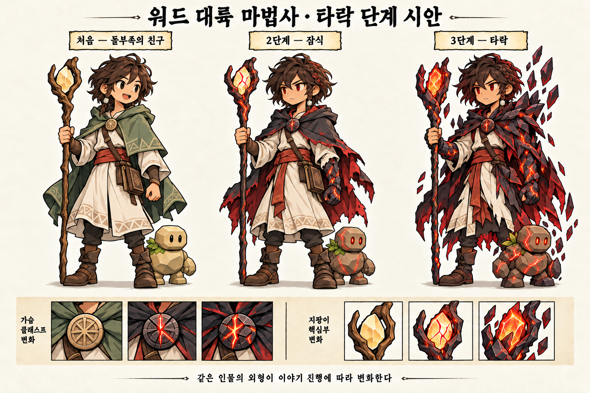
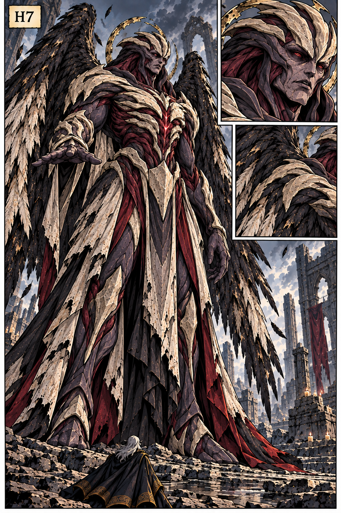

# 등장인물 프로필과 외형 기준

## 2026-10-30 반복 작화용 프로필 추가

개별 프로필 원화는 references/defense-production-v1/mages/에 제작한다. 기존 미라·핀·오린의 성격과 관계는 유지한다. 새 방어 마법사들은 이름 미정인 동료이며 아래 작업 ID로 같은 인물을 반복한다. 그림을 만들기 위해 나이·성별·가족사·새 능력을 정하지 않는다.

| 작업 ID | 고정 외형과 소품 | 원화 |
|---|---|---|
| MAGE_BLUE / 미라 | 긴 갈색 머리, 검은 타원 눈, 파란 망토, 금색 마름모 브로치, 푸른 수정 지팡이, 카드 가방 | references/defense-production-v1/mages/mira.png |
| MAGE_GREEN / 핀 | 짧고 흐트러진 갈색 머리와 작은 옆 땋은 가닥·밝은 구슬, 둥근 브로치, 녹색 망토, 호박빛 갈래 지팡이, 카드 가방. 이 프로필은 잠식 전 기준 | references/defense-production-v1/mages/finn.png |
| MENTOR / 오린 | 긴 흰 머리·수염, 뜬 눈과 엄격한 표정, 자주색 로브와 금색 테, 둥근 나무 옹이 머리 지팡이, 카드 가방 | references/defense-production-v1/mages/orin.png |
| DEFENDER_TEAL | 짧게 넘긴 회색 머리, 안경·수염 없음, 청록 망토, 둥근 황동 브로치, 작은 푸른 삼각 수정 지팡이, 카드 가방 | references/defense-production-v1/mages/defender-teal.png |
| DEFENDER_PLUM | 옆으로 넘긴 자주색 단발, 안경·수염 없음, 짙은 자주 망토, 작은 사각 금색 브로치, 작은 호박빛 사각 수정 지팡이, 카드 가방 | references/defense-production-v1/mages/defender-plum.png |
| DEFENDER_OCHRE | 짧은 금발과 둥근 안경, 황토색 망토, 작은 둥근 금색 브로치, 작은 금색 구슬 지팡이, 두꺼운 카드 가방 | references/defense-production-v1/mages/defender-ochre.png |

셋의 성격은 새 과거사보다 현재 행동으로 구분한다. 청록 동료는 진지의 간격을 확인하고 짧게 보고한다. 자주 동료는 카드와 장비를 확인한 뒤 필요한 것을 건넨다. 황토 동료는 대피 인원과 부상자를 살피고 동료에게 위치를 알린다. 새로운 고유 마법 능력이나 직책을 이 역할만으로 확정하지 않는다. 설정화의 얼굴·머리·브로치·장비는 매 장면 새로 만들지 않는다.

2026-10-29 수정한 프로필 v5이다. 이름과 아침 일상 도입, 오린의 엄격하고 권위 있는 연기를 반영했다.
이후 대본·대사·작화에서 이 문서를 공통 기준으로 쓴다.
사용자가 정한 설정과 이번 요청으로 구체화한 작업용 성격을 구분한다.
새로 정리한 성격은 후속 회차마다 다시 만들지 않고, 수정할 때 이 문서부터 갱신한다.
1화는 공동 실험 대신 테라스에서 아침을 먹고 농담하는 장면으로 시작한다.
연구 주제는 배경 제안이며 첫 화의 설명 과제로 삼지 않는다. 둘이 연구실을
차린다는 목표와 독립 연구·졸업 조건은 채택하지 않았다.
현재 이름은 미라(MAGE_BLUE), 핀(MAGE_GREEN), 오린(MENTOR), 모크(MINIROCK_COMPANION)다.
미라·핀의 정확한 나이·성별·가족사·학위 제도는 미정이다. 오린은 늙은 남성 마법사다.
짧은 외국 판타지풍 이름을 사용한다. 이름의 실제 언어 어원이나 뜻은 별도로 확정하지 않는다.
구체적인 호칭·말투·비언어 연기는 [DIALOGUE.md](DIALOGUE.md)를 따른다.
모두를 포괄하는 성격 검사 유형이나 임의의 비극적 과거를 붙이지 않는다.
배후 설정은 [WORLD.md](WORLD.md), 그림체는 [COMIC-STYLE.md](COMIC-STYLE.md)를 따른다.

## 등장인물 목록

| 작업 식별자 | 대본 호칭 | 역할 | 프로필 상태 |
|---|---|---|---|
| `MAGE_BLUE` | 미라 | 세계수로 현장 연구를 떠나는 성인 연구생 | 기존 외형·연구생 방향에 맞춰 성격 v3 유지 |
| `MAGE_GREEN` | 핀 | 돌골렘 마을로 떠나 차원문 사건을 겪는 성인 연구생 | 기존 외형·타락 흐름에 맞춰 성격 v3 유지 |
| `MENTOR` | 오린 선생님 | 두 연구생을 지도하는 할아버지 마법사 | 노년 남성·말투 반영, 상세 작화는 별도 |
| `MINIROCK_COMPANION` | 모크 | 핀과 친해지고 처음 붉은 눈이 되는 미니록 | 말하지 않는 친구, 이름은 핀이 붙인 별명 |
| `SPIRIT_HOST` | 따라붙는 정령 | 미라와 가까워지는 현지 개체 | 비언어 동료 역할 제안, 등장 미확정 |
| `ROCK_HOST` | 큰 돌골렘 | 미니록 곁에서 핀을 살피는 큰 개체 | 비언어 동료 역할 제안, 등장 미확정 |
| `DIMENSION_CARRIER` | 차원유랑종 | 멸망한 세계 조각을 품은 존재 | 역할만 정리, 인격·개체 관계는 미정 |
| `MASTERMIND` | 목소리 / 흑막 | 차원유랑종을 통해 영향력을 넓히는 존재 | 현재 악역 방향에 맞춘 작가용 연기 기준, 세부 미정 |

식별자는 대본과 제작 메모용이다. 독자에게 이름처럼 노출하거나 게임 키를 바꾸지 않는다.
두 주인공은 이번 작업에서 같은 연구실의 동기·친구로 운용한다. 탑에서 함께
연구하며 친해진 편한 친구다. 상대의 성과를 속으로 의식하지만 평소에는 서로 돕고 장난친다.
매번 경쟁을 선언하거나 비꼬는 관계로 만들지 않는다. 소꿉친구·가족·연애 관계는 추가하지 않는다.
정령과 돌부족은 사람 말 대신 동물이나 어린아이처럼 몸짓·표정·짧은 발성으로 표현한다.
현지 개체는 관리직이나 설명 담당이 아니라 함께 지내는 생명체다.

## 돌부족과 친한 마법사

### 핀 / MAGE_GREEN — 성격과 연기

- **기본 인상:** 평소에는 붙임성 있고 잘 웃는다. 궁금한 것이 생기면 대화가 길어지고,
  동료가 지쳐 보이면 말보다 먼저 손을 보탠다.
- **바라는 것:** 돌골렘이 실제로 어떻게 움직이는지 자기 눈으로 이해하고,
  자기 관찰로 설명할 수 있는 결과를 내고 싶다. 미라가 칭찬받으면 자기도 좋은 결과를
  보여주고 싶어 하지만 친구의 연구를 방해하지 않는다. 지배욕은 동기가 아니다.
- **강점:** 움직임의 작은 차이를 빨리 알아보고 마법을 손으로 다루는 데 익숙하다.
  현지 인물들과 관계를 맺고 관찰할 시간을 만든다.
- **약점:** 재미있는 결과를 따라가다 정리와 준비를 뒤로 미룬다. 도움을 준 뒤에야
  자기 일정이 밀렸다는 것을 깨닫는다. 단순히 머리가 나쁘거나 위험을 즐기는 인물은 아니다.
- **말투:** 친구에게 편한 반말, 지도 마법사에게 하십시오체, 처음 만난 이에게 존댓말을 쓴다.
  제안과 질문이 많고, 실수하면 길게 변명하기보다 “아, 그건 빼먹었다” 하고 인정한다.
- **습관:** 도구를 직접 만지며 생각하고, 설명할 때 작은 물체를 움직여 보여준다.
  상대가 곤란해하면 일단 몸을 일으킨다. 장식이나 말버릇을 매 컷 반복하지 않는다.
- **스트레스 반응:** 평소에는 농담하지만 문제가 커지면 말이 짧아지고 상대의 상태부터 살핀다.
  걱정되는 친구가 사라지면 연구 성과보다 찾는 일을 먼저 한다.
- **자연스러운 대사:** “잠깐, 한 번만 더 해 보자.” / “그거 이리 줘. 내가 들게.” / “기록은?”
- **속으로 하는 경쟁:** 미라의 관찰이 맞으면 잠깐 멈췄다가 “오, 맞네” 하고 인정한다.
  돌아와 자기 기록을 더 본다. 질투를 곧바로 빈정거리는 대사로 바꾸지 않는다.
- **피할 연기:** 사고만 내는 바보, 실험체를 함부로 다루는 연구자, 처음부터 악마의 힘을
  원하는 인물, 미니록을 유물 발견을 위한 도구로 취급하는 모습.

### 타락 이후에도 같은 인물로 보이는 기준

| 상태 | 표정·말투·행동 | 유지할 것 |
|---|---|---|
| 처음 | 잘 웃고 질문하며 주변 반응을 기다린다. 친구가 부르면 돌아본다. | 옆머리의 땋은 가닥, 돌 장식, 지팡이와 둥근 가슴 장식 |
| 2단계 잠식 | 질문과 농담이 줄고 시선이 오래 고정된다. 대답이 짧아지며 명령을 실행한다. | 손으로 도구를 다루는 습관과 본래 동작의 리듬 |
| 3단계 타락 | 낯선 악당처럼 웃거나 연설하지 않는다. 아는 장소와 상대 앞에서도 멈추지 않는다. | 같은 얼굴의 비율과 익숙한 자세, 처음부터 함께하던 소품 |

잠식 후에도 미니록을 보호하는 행동이 반드시 남는다거나, 친구의 말에 바로
정신을 되찾는다고 확정하지 않는다. 저항과 회복 여부는 후속 이야기의 미결 사항이다.

차원문이 열린 사건의 근처에 있던 인간과 바위 골렘은 모두 목소리에 잠식된다. 3화 시점의 핀을 아직 정상인 채 모크나 주변 인간·바위 골렘을 구조하려는 인물로 되돌리지 않는다. 외형 변화가 점진적이라고 해서 잠식도 아직 시작되지 않은 것으로 해석하지 않는다.

- 워드 대륙의 마법 연구생이다. 대학원생처럼 연구와 보고에 시달리는 일상에서 시작한다.
- 돌골렘 마을로 현장 연구를 떠나 친구가 된 미니록을 따라가 차원문 사건을 겪는다.
- 갈색의 짧고 흐트러진 머리, 옆머리의 작은 땋은 가닥과 돌 구슬을 유지한다.
- 처음에는 녹색 망토, 밝은 로브, 흙빛 허리띠, 카드 가방과 갈래진 나무 지팡이를 쓴다.
- 가슴의 둥근 돌 장식과 지팡이는 타락 전후 같은 인물임을 보여주는 고정 특징이다.
- 잠식되면 눈빛과 장식·지팡이의 균열, 어두워진 망토와 팔의 갑각이 드러난다.
- 타락 단계에서는 붉고 검은 갑각과 날카로운 어깨 실루엣이 강해진다.
- 처음 / 2단계 잠식 / 3단계 타락만 남긴다. 삭제한 1단계 목소리 외형을
  별도 스킨으로 되살리거나, 세 단계의 이름을 임의로 다시 매기지 않는다.
- 외형 시트는 선택한 방향의 참고다. 게임 스프라이트로 제작·적용된 상태는 아니다.

[차원문 사건 만화](references/portal-origin.png)에서 처음의 일상과 잠식 직후를 볼 수 있다.
이 시안의 모든 대사나 장치 모양이 확정된 것은 아니다.

## 자연 쪽 마법사 후보

기존 게임의 긴 갈색 머리, 파란 망토, 회색 로브, 푸른 결정 지팡이를 가진 인물을
자연 쪽 주인공으로 쓰는 안이다. 기존 자료의 수습 마법생 외형을 참고하되,
연재에서는 연구를 진행하는 성인 연구생으로 다루며 세계수로 현장 연구를 떠난다.
[게임 외형 참고](references/subjects/apprentice-mage.png)는 생김새 확인용이며
만화 기법은 COMIC-STYLE.md를 따른다.
두 주인공의 연구생 일상은 최신 방향이다. 같은 연구실의 동기·친구로 운용하며,
구체적인 연구 주제는 [1화 구성안](episodes/001/PLAN.md)의 제안이다.

### 미라 / MAGE_BLUE — 성격과 연기

- **기본 인상:** 꼼꼼하고 무뚝뚝해 보이지만, 남을 챙기는 일을 쉽게 지나치지 못한다.
  친한 사람에게는 짧고 건조한 농담을 한다. 항상 옳은 모범생은 아니다.
- **바라는 것:** 기록 사이의 모순을 자기 관찰로 설명하고 싶다. 보고에서 답하지
  못할까 봐 필요 이상으로 자료를 준비한다. 핀이 먼저 원인을 알아차리면
  자극받아 자기 해석을 다시 확인한다. 상대가 실패하기를 바라지는 않는다.
- **강점:** 작은 차이와 빠진 조건을 잘 찾고, 결과를 남이 다시 확인할 수 있게 정리한다.
  급할수록 사고를 제어하고 필요한 자료와 사람을 챙긴다.
- **약점:** 충분히 준비해야 시작할 수 있다고 생각해 짐과 절차가 늘어난다.
  예상 밖의 반응을 받으면 설명을 더하다 상대를 지치게 만들기도 한다.
- **말투:** 친구에게 반말, 지도 마법사에게 하십시오체, 처음 만난 이에게 존댓말을 쓴다.
  조건을 확인하는 질문과 짧은 지적이 많다. 피곤할 때 대답이 더 짧아진다.
- **습관:** 대답 전에 수첩을 넘기거나 기록을 가리킨다. 불평하면서도 여분을 챙겨준다.
  매번 안경을 올리거나 없는 소품을 만들어 습관을 표시하지 않는다.
- **스트레스 반응:** 말이 빨라졌다가 결정을 내리면 조용해진다. 잘못했을 때는
  기록을 고치며 인정한다. 정령이 협조하지 않는다고 명령하거나 위협하지 않는다.
- **자연스러운 대사:** “이번에도 같은 조건이지?” / “잠깐, 하나만 더 확인하자.” /
  “빌려주는 거야.”
- **속으로 하는 경쟁:** 핀이 칭찬받을 때 펜이 잠깐 멈추거나 다음 보고 자료를
  다시 펼친다. 겉으로는 먼저 “잘됐네”라고 말할 수 있다.
- **피할 연기:** 감정 없는 설명 담당, 핀을 늘 가르치는 보호자, 자료만 믿고
  눈앞의 생명체를 무시하는 인물, 편의를 위해 매번 정답을 아는 주인공.

## 지도 마법사 오린 — MENTOR

- **위치:** 두 연구생을 지도하는 노년 남성 마법사다. 학생들은 “선생님”이라 부른다.
- **외형과 연기:** 긴 흰 머리·수염, 낡은 자주색 로브, 무거운 눈썹과 열린 눈을 유지한다. 상체를 곧게 잡고 상대를 똑바로 본다. 상시 미소·웃는 눈·반가운 손짓을 쓰지 않는다.
- **성격:** 엄격하고 권위 있다. 적은 말과 절제된 동작으로 상대가 자세를 바로잡게 한다. 고함·모욕·분노·악역의 위압으로 바꾸지 않는다.
- **바라는 것:** 학생들이 직접 본 것을 근거로 판단하는 것. 이전 보고서도 읽고 부족한 관찰을 짚는다. 학생을 버리거나 성과를 가로채는 인물은 아니다.
- **말투:** 다나까체로 짧고 단정적으로 말한다. “이제 현장 연구를 시작한다.” / “내일 아침이다.” / “추측으로 채우지 않는다.” 학생들은 하십시오체로 답하고 둘끼리는 반말을 쓴다.
- **공간:** 교수 연구실의 큰 책상 뒤 높은 등받이 의자에 앉는다. 학생들은 맞은편 방문용 의자에 앉는다. 왕좌·알현실로 과장하지 않는다.
- **소품:** 자료를 책상 위에서 밀어 건네고 학생은 내려다보거나 접어 챙긴다. 같은 도표를 관객에게 계속 세워 보여주지 않는다.
- **피할 연기:** 상냥한 미소를 반복하는 할아버지, 노쇠함 개그, 학생을 벌주려고 위험에 보내는 인물, 전지전능한 지도자나 임의의 배후 공모자.
## 미니록 친구 모크 — MINIROCK_COMPANION

- **위치:** 돌골렘 마을에서 핀과 친해지는 한 개체. 핀이 모크라는 별명을 붙인다.
  스스로 사람 말로 이름을 소개하지 않는다. 종족 전체와 구분한다.
  붉은 눈이 되어 동굴에 들어가는 역할은 유지한다.
- **평소 성격:** 반응이 빠르고 장난을 좋아한다. 낯선 사람을 먼저 살피지만
  익숙해지면 같은 놀이를 다시 해 달라며 먼저 다가온다.
- **바라는 것:** 재미있는 놀이와 친구의 반응. 감춰진 비극이나 유물에 대한
  지식을 처음부터 가진 존재로 만들지 않는다.
- **행동 습관:** 고개를 기울여 살피고, 짧게 뛰어 손을 들거나 핀의 소매를
  건드린다. 작은 돌을 굴려 놀이를 청한다. 지팡이를 뺏는 등 위험한 장난을 상시 반복하지 않는다.
- **의사 표현:** 사람 말은 하지 않는다. 호기심에 “꾸?”, 신날 때 “꾸!” 같은 짧은 소리와
  몸짓을 쓴다. 매 컷 발성을 넣지 않는다. 핀의 긴 문장을 정확히 이해하고 대답하는 대신
  반복 경험과 상황을 보고 반응한다. 발성은 인간 문장으로 번역하지 않는다.
- **붉은 눈 이후:** 부름에 반응하지 않고 놀이에 관심을 잃는다. 같은 외형과 동작이
  낯설게 바뀌는 것이 단서다. 사악한 웃음이나 자발적인 배신으로 바꾸지 않는다.
- **피할 연기:** 주인공 소유의 애완돌, 말 못 하는 바보, 원래 유적을 노리던 악당,
  종족 전체가 똑같은 성격과 행동을 한다는 표현.

## 후속 회차용 개체 — 아직 등장 미확정

### 따라붙는 정령 — SPIRIT_HOST

- **눈과 상태:** 정상적인 검은 타원 눈을 유지한다. 2화의 자연 정령은 타락하지 않으며,
  붉은 눈·발광하는 눈·검붉은 오염 무늬를 넣지 않는다. 겁먹고 피하는 반응만 보인다.

- 미라에게 관심을 보이는 현지 개체다. 말하는 안내자나 접수 담당자가 아니다.
- 호기심이 많고 주의가 쉽게 옮겨가며 자기 자리와 익숙한 놀이를 좋아한다.
- “피?”, “피!” 같은 짧은 발성, 몸 기울이기·점프·잎과 꼬리 움직임으로 표현한다.
- 사람 말, 문장으로 된 속마음, 인간 문장으로 번역한 자막은 쓰지 않는다.
- 미라는 긴 설명 대신 한 동작씩 보여주며 의사를 확인하는 법을 배운다.
- 종류·개체 이름·상세 외형은 미정이다. 애완동물이나 세계관 해설자로 쓰지 않는다.

### 큰 돌골렘 — ROCK_HOST

- 미니록들 곁에 머무는 큰 개체다. 촌장·행정 담당자·말하는 장로로 만들지 않는다.
- 작은 개체를 조심히 다루고 낯선 접근에는 몸을 사이에 둔다.
- 낮은 “우웅”, 몸 기울이기·손짓·바닥 두드리기로 경계·거절·안도를 보인다.
- 느린 동작을 낮은 지능으로 그리지 않는다. 긴 인간 문장이나 기술·역사 설명은 하지 않는다.
- 핀이 미니록과 안전하게 노는 모습을 보며 접근을 허용하는 흐름을 제안한다.
- 연구 허가서를 읽거나 말로 협약을 맺는 식으로 바꾸지 않는다.

## 흑막 외형 후보

### MASTERMIND — 작가용 성격과 연기

- **기본 인상:** 대화와 판단이 가능한 존재다. 목소리는 차분하고 지시는 분명하다.
  상대의 고통에 공감해 계획을 멈추는 인물로 쓰지 않는다.
- **행동 원칙:** 상대를 설득의 대상보다 움직일 수 있는 존재로 대하는 방향이다.
  의지를 잠식하는 행동이 악역의 성격을 드러낸다.
- **말투:** 초반에는 “세계수로 향해라”, “공격해라” 같은 짧은 명령만 쓴다.
  자기소개·과거·철학을 길게 설명하거나 웃음소리로 정체를 암시하지 않는다.
- **시각 연기:** 생각하는 눈과 절제된 손짓, 급하게 몸을 움직이지 않는 자세를 쓴다.
  다만 본체는 공개 시점까지 작가용 자료에만 남긴다.
- **미정:** 이름·기원·구체적 목적·능력 한계·봉인 방식·약점·최후.
  침착한 성격을 절대 패배하지 않는 능력으로 해석하지 않는다.
- **피할 연기:** 자기 세계를 구하려는 피해자, 원래 궁정 마법사였다는 설정,
  명령이 통하지 않자 곧바로 소리 지르는 악당, 긴 설명으로 초반 반전을 지우는 것.

- 사람형 얼굴과 몸, 말과 판단이 가능해 보이는 표정과 손짓을 유지한다.
- H4의 얼굴·넓은 체격·생체 갑각과 H6의 검게 상한 날개·부서진 후광·낡은 예복을
  결합한 H7이 현재 탐색 중인 안이다.
- [H4](references/H4.png)와 [H6](references/H6.png)는 H7의 원본 참고다.
- 사람형을 선호한다는 결정과 H4·H6 결합 요청은 반영한다.
  H7 이미지 전체를 최종 승인하거나, 천사 종족·과거 직업·타락 원인을 확정한 것은 아니다.
- 작가용 기준 이미지가 있어도 초반 독자에게 얼굴과 정체를 공개하지 않는다.

## 기존 소환수의 외형

### DIMENSION_CARRIER — 차원유랑종의 현재 기준

- 멸망한 세계 조각을 품고 이동하며 그 안의 흑막에게 조종당하는 존재다.
- 외형은 기존 차원운반자 한 형태로 제한하지 않는다. 다리 있는 형태와 다리 없이 부유하는 형태, 둥글거나 길쭉하거나 납작한 몸 등 여러 변주를 둔다. 몸 안에 공간을 품는 점을 이어가며, 종류별 이름·능력·기원은 아직 정하지 않는다.
- 본체의 의사·감정·언어·동기와 개체별 관계는 아직 정하지 않았다.
  흑막의 말과 판단을 차원유랑종 자신의 성격으로 기록하지 않는다.
- 조종받는 상태와 원래의 행동은 구분한다. 종족 전체가 원래 악하다고 확정하지 않는다.
- 미니록이나 연구생과의 직접적인 유대, 회복·구출·죽음의 결말을 임의로 만들지 않는다.

### 외형 자료

| 대상 | 파일 | 유지할 특징 |
|---|---|---|
| 미니록 | [mini-rock.png](references/subjects/mini-rock.png) | 작은 돌 몸, 둥근 머리와 타원 눈, 어깨의 이끼·잎 |
| 돌 골렘 | [rock-golem.png](references/subjects/rock-golem.png) | 따뜻한 돌색, 육중한 몸, 이끼와 잎 |
| 덩굴 정령 | [vine-spirit.png](references/subjects/vine-spirit.png) | 둥근 연두색 몸, 잎 장식과 말린 덩굴 |
| 나무 골렘 | [tree-golem.png](references/subjects/tree-golem.png) | 나무 몸통과 팔다리, 머리·어깨의 잎 |
| 불 계열 악마 | [fire-spirit.png](references/subjects/fire-spirit.png) | 낮은 네발 체형, 검정·진홍 갑각, 주황빛 눈과 틈 |
| 큰 불 계열 악마 | [fire-lord.png](references/subjects/fire-lord.png) | 길쭉한 부유 갑각, 주황빛 고리 |
| 차원유랑종 | [dimension-carrier.png](references/subjects/dimension-carrier.png) | 보라색 돌껍질, 몸 안에 보이는 세계 조각 |

이 파일들은 기존 게임 자산에서 복사한 외형 참고다. 로컬 경로를 찾지 못해도
인물을 새로 발명하지 않도록 연재 레포 안에 보관한다.
현재 게임의 기술·병기 자산이 남아 있어도 별도 인간 문명이 있다는 근거로 쓰지 않는다.

## 인물 사이의 관계와 대사 기준

| 관계 | 기본 호흡 | 바꾸지 않을 점 |
|---|---|---|
| 미라 ↔ 핀 | 겉으로는 편하게 돕는 친구, 속으로는 상대의 연구 성과를 의식하는 동기다. | 한쪽만 유능한 보호자이고 다른 쪽만 사고를 내는 관계로 만들지 않는다. |
| 연구생 ↔ 지도 마법사 | 둘은 오린을 선생님이라 부르며 하십시오체로 보고하고, 오린은 다나까체로 짧고 단정적으로 말한다. | 불만과 부담은 있어도 학대나 적대 관계를 기본값으로 두지 않는다. |
| 핀 ↔ 미니록 | 반복된 놀이와 반응 관찰로 친해진다. | 걱정해서 동굴에 따라간다는 동기를 유지한다. |
| 미라 ↔ 따라붙는 정령 | 몸짓과 반응을 보며 의사를 맞춰가는 관계다. | 정령은 연구생의 소유물이나 측정용 도구가 아니다. |
| 핀 ↔ 큰 돌골렘 | 함께 지내고 안전하게 행동하며 경계를 풀어가는 관계다. | 인간이 돌부족을 지배하거나 기술을 전해주는 문명 서사를 추가하지 않는다. |
| 흑막 → 잠식된 존재 | 짧은 명령과 반응의 소실로 표현한다. | 잠식 이후의 행동을 원래 성격이나 자발적 동맹의 증거로 쓰지 않는다. |

같은 질문에 대한 반응 예시: 관찰 결과가 예상과 다를 때 미라는 “조건이 달랐나?
기록부터 보자”, 핀은 “어디서 바뀌었는지 한 번 더 볼까?”라고 말한다.
둘 다 생각하고 관찰한다. 이성적인 인물과 생각 없는 인물로 나누지 않는다.

## 회차를 이어갈 때의 확인

- 대본에 등장인물 식별자와 사용한 프로필 버전을 적고, 달라지는 행동에는
  사건·피로·관계 변화 같은 이유가 있는지 확인한다.
- 새 습관·말버릇·능력·가족사·직책을 대사 편의를 위해 매번 만들지 않는다.
- 성격의 변화는 회차의 사건에 따라 남긴다. 타락한 인물이 다음 화에 설명 없이
  평소의 농담을 하는 식으로 상태를 되돌리지 않는다.
- 프로필 수정은 이 문서를 먼저 바꾸고 영향을 받는 대본을 확인한다.
  이미 쓴 대사와 충돌하면 둘 중 하나를 의도적으로 고치고 변경 이유를 남긴다.
- 다음 화에 이어질 상태는 해당 회차의 작가용 마무리 메모에 짧게 기록한다.
  등장 미확정 인물이나 미결 사항을 프로필을 채우기 위해 확정하지 않는다.

## 카드 마법과 소품의 연속성

미라와 핀은 지팡이만 쓰는 인물이 아니다. 카드 가방에서 실제 카드를 꺼내고,
카드를 향하거나 펼친 뒤 마법이 발동하는 연결을 화면에 보여준다. 카드 그림은
주문을 식별하는 단순한 표식으로 정리하고, 아직 정하지 않은 카드 이름·비용·등급을 넣지 않는다.
지팡이는 자세를 잡거나 마법을 보조하는 소품이다. 소모·재충전·복제 같은 카드 규칙은
그림만으로 새로 확정하지 않는다.
