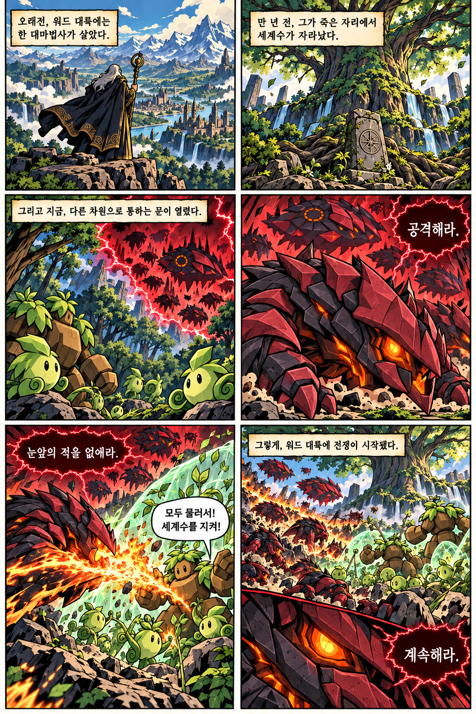
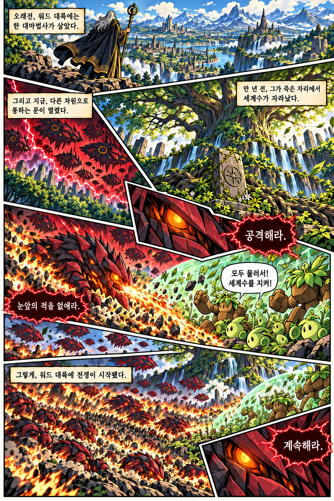
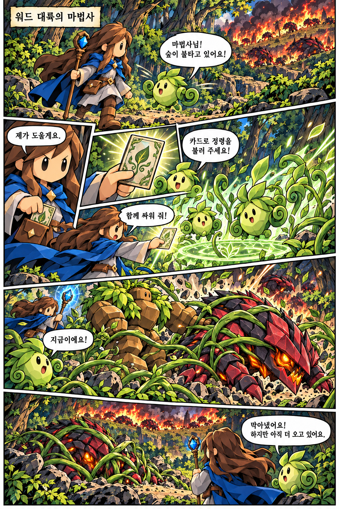

# 연재 만화 그림체와 연출

게임 스프라이트와 별도로 승인한 미국 판타지 코믹스풍을 사용한다.
게임 캐릭터의 생김새는 유지하고, 그림을 그리는 기법은 만화에 맞춘다.
세계관은 [WORLD.md](WORLD.md), 인물별 외형은 [CHARACTERS.md](CHARACTERS.md)를 따른다.

## 기준 이미지



[그림체 기준 원본](references/comic-style.png)은 굵은 선과 색면을 확인하는 자료다.
초기 2열 3행 배치는 고정 양식이 아니다. 그 안의 대사와 사건도 회차마다 반복하지 않는다.



[칸 구성 시안](references/prologue-layout.png)은 넓은 전경, 대각선 칸과 삽입 컷의 참고다.
이 이미지의 사건 순서나 글자를 그대로 복사하지 않고 실제 대본과 읽는 순서를 검수한다.

## 그림체

### 배경에도 같은 작화 기준 적용

인물과 배경에 다른 렌더링을 쓰지 않는다. 배경만 부드러운 회화풍·실사풍
콘셉트 아트로 바뀌지 않도록 굵은 검은 윤곽선·큰 색면·경계가 분명한 셀 명암을
공통으로 사용한다. 풀과 나뭇잎은 덩어리로 정리하고, 개별 잎·풀잎·꽃의 미세한
묘사나 점 질감이 화면을 채우지 않게 한다. 산도 능선과 큰 바위 면부터 읽히게 한다.
완성 배경을 기존 만화와 나란히 놓고 선 굵기와 명암 방식을 비교한다.

초원은 하이랄 평원처럼 탁 트인 공간·완만한 언덕·곁의 산맥이 느껴지는 방향이다.
이는 지형의 인상 참고이며 별도 작품의 그림체나 건축물을 가져오는 지시가 아니다.
인간 건축물은 마법 타워 하나만 둔다. 카메라는 더 높은 시점에서 초원과 산을
함께 내려다보는 방향으로 조정한다. 대륙 지도는 geography/word-continent-v1/에서
위치 참고로만 사용한다. 만화는 별도의 풍경 구도로 이어 그린다.

### 1화 수정에서 고정한 인물 기준



[기존 튜토리얼 만화](references/comic-character-style.png)의 단순한 얼굴과
검은 타원형 눈, 굵은 윤곽선을 인물 작화의 우선 기준으로 쓴다.
그 이미지의 말하는 정령과 사건은 최신 설정에 적용하지 않는다.
작은 입과 단순한 코, 묵직하고 짧은 신체 비율을 유지한다.
세밀한 눈동자·속눈썹과 길어진 애니메이션 체형으로 바꾸지 않는다.
성인 연구생이라는 설정을 실사에 가까운 얼굴 비율로 해석하지 않는다.

타락 스킨 시트는 의상과 외형만 참고한다. 얼굴을 그리는 방법은 이 만화에서
가져온다. 직전 생성물이 기준에서 벗어나면 다음 장의 그림체 참고로 쓰지 않는다.
1화의 첫 작화 art/page-01.png부터 page-06.png까지는 그림체가 반려된 시안이다.
과거 수정본은 episodes/001/art-v2/에 보존한다. 수정본 생성 자체를 사용자 승인으로
기록하지 않는다.

이후 1화 도입이 테라스 아침 식사로 바뀌어 기존 art/와 art-v2/의 사건도
현재 대본과 맞지 않는다. 두 폴더는 이전 시안으로 보존하고, 작화 재개 시
episodes/001/PLAN.md의 최신 대본과 selected-pages.json의 선택본을 따른다.

- 굵기 변화가 있는 검은 윤곽선과 큰 색면, 단순한 셀 명암을 사용한다.
- 해칭과 하프톤은 제한적으로 쓴다. 미세 질감보다 실루엣·표정·동작이 먼저 읽혀야 한다.
- 인물은 과장되고 묵직한 비율로 그리되, 외형 기준에서 체형을 임의로 바꾸지 않는다.
- 배경도 선과 색면으로 정리한다. 숲의 녹색과 불지옥의 붉은색을 구분한다.
- 실사 피부, 사진 같은 풍경, 세밀한 금속 질감, 3D 렌더 느낌을 피한다.
- 게임의 다면체 cut-paper 기법을 그대로 복사하지 않는다.
- 외부 작품은 분위기·체형·복식의 참고다. 기존 캐릭터의 얼굴이나 복식을
  연재 캐릭터로 그대로 확정하지 않는다.

## 칸 구성과 글자

[구성·대사 자료 검토](references/comic-writing-notes-20261029.md)의 적용 기준을 함께 확인한다.
지도는 위치 참고다. 실제 만화 전경에 대륙 전체 해안선과 지도 구도를 복사하지 않는다.
화면 밖으로 땅이 이어지는 전경·중경·원경으로 넓이를 보여준다.
대화 컷에서는 같은 상세 배경과 두 사람의 상반신을 계속 반복하지 않고
손·소품·표정·침묵을 골라 쓴다. 컷을 나누기 전에 말풍선의 순서와 공간을 정한다.

- 일정한 크기의 사각 격자를 기본값으로 쓰지 않는다.
- 넓은 전경, 작은 표정·손·카드 삽입 컷, 대각선 칸을 장면에 맞게 섞는다.
- 일부 동작이나 날개가 칸 경계를 넘어도 된다. 읽는 순서를 흐리면 줄인다.
- 밝은 여백과 검은 테두리로 칸을 구분한다. 시간 순서와 대사 순서를 우선한다.
- 설명은 밝은 사각 상자, 보통 대사는 흰 말풍선에 넣는다.
- 머릿속 명령은 검붉은 바탕, 붉은 가장자리와 밝은 글자로 구분한다.
- 머릿속 말풍선이 외부 인물을 지목하는 꼬리를 만들지 않는다.
- 한국어는 실제 표시 크기에서 읽을 수 있게 배치한다. 승인된 대사를 그대로 쓴다.

## 인물과 장면 참고의 역할

- references/comic-style.png: 그림을 그리는 방법.
- references/prologue-layout.png: 칸 크기와 형태를 다양하게 쓰는 방법.
- references/portal-origin.png: 미니록과 마법사의 차원문 사건 시안.
- references/mage-corruption.png: 남기기로 한 세 가지 외형.
- references/H4.png, H6.png, H7.png: 흑막의 외형 탐색, 최종 승인 아님.
- references/subjects/: 기존 게임 소환수의 생김새. 그림체 기준으로 쓰지 않는다.

초기 차원문 만화의 눈빛·가슴 장식 변화는 장면 연출이다.
독립 스킨은 세 가지이며 삭제한 1단계 스킨을 다시 추가하지 않는다.
이전 이미지가 세계관과 충돌하면 최신 WORLD.md를 우선한다.

## 재사용 프롬프트

아래 문구 뒤에 회차 대본과 정확한 대사를 덧붙인다. 기준 만화와 등장인물의
외형 자료를 첨부하고 각 이미지의 역할을 명시한다.

```text
Create a hand-drawn American fantasy adventure comic with bold variable-width
black contours, large flat color fields, controlled cel shadows and restrained
hatching/halftones. Use the approved comic reference for rendering only, and
character/creature sheets for identity, silhouette and palette only.
Avoid photorealism, CGI, fine noisy textures and faceted sprite rendering.
Use unequal asymmetric panels, wide establishing views, small closeup insets,
diagonal borders and selective border-breaking action. Preserve clear reading
order. Use cream narration boxes, white ordinary dialogue, and dark crimson
psychic balloons with pale letters and no external-speaker tail.
Render the supplied Korean text verbatim. Do not add dialogue, reveal the
mastermind early or infer story canon from old reference artwork.
```

## 확인

- 그림체 기준과 나란히 비교해 선·명암·디테일 밀도를 확인한다.
- 등장인물의 외형과 타락 단계를 확인한다.
- 칸과 말풍선의 읽는 순서, 한국어 가독성, 원문 대사와의 일치를 확인한다.
- 새 배경·장치·관계·기원을 이미지 생성기가 임의로 확정하지 않았는지 본다.
- 독자 공개 범위를 넘어 흑막과 목소리의 정체를 보여주지 않았는지 확인한다.

## 최신 대사·마법 기준

말투와 비언어 연기는 [DIALOGUE.md](DIALOGUE.md)를 따른다.
돌부족과 정령에게 사람 대사나 번역 자막을 넣지 않는다. 기존 참고 이미지의
말하는 정령은 이전 시안이다. 미라와 핀의 마법 장면에는 카드와 발동 동작이
함께 보여야 한다. 카드 없이 지팡이만 휘두르는 연출로 계속 대체하지 않는다.

## 2026-10-30 마법 타워 외형 변경

[승인된 탑 외형](references/mage-tower-approved-20261030.md)을 따른다. 회백색 주탑·상부 푸른 수정·원형 외벽·안뜰이 기준이며 기존 파란 원뿔 지붕 탑으로 되돌리지 않는다. 먼 풍경에서도 수정과 주탑·낮은 외벽의 크기 관계를 유지한다.
