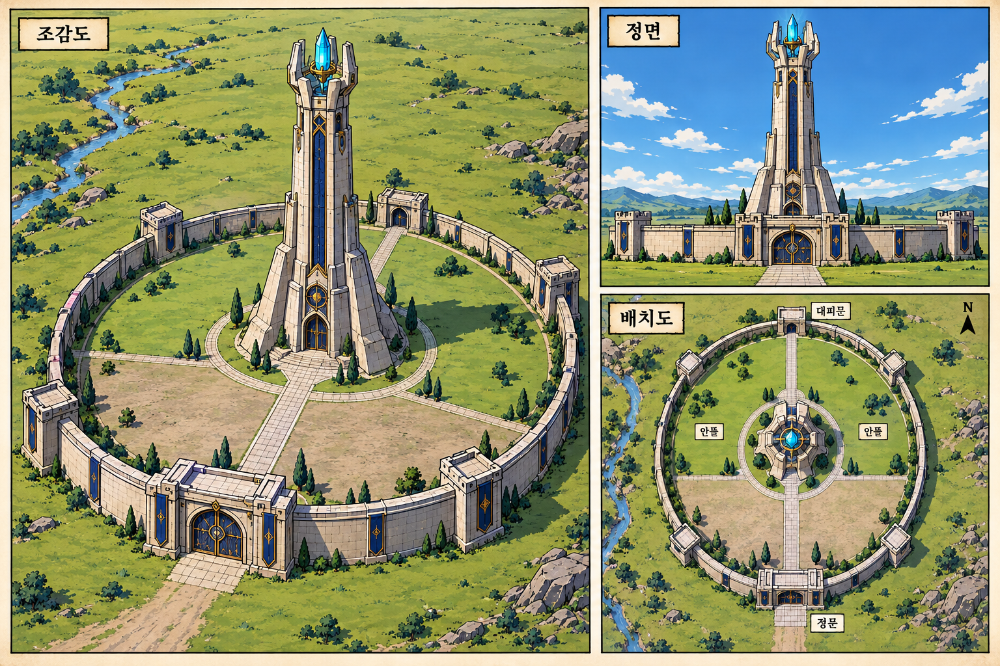

# 마법 타워 외형 확정

2026-10-30 사용자가 첨부한 조감도·정면·배치도 이미지를 새 외형 기준으로 승인했다.

- 회백색 돌로 된 높은 중앙 주탑과 아래로 벌어지는 지지벽을 사용한다.
- 꼭대기는 돌 기둥이 감싸는 푸른 수정이며, 세로의 짙은 파란 장식과 금색 테두리가 있다.
- 낮은 원형 외벽과 작은 사각 망루가 넓은 잔디 안뜰을 둘러싼다.
- 앞쪽 정문과 맞은편 대피문을 중앙 탑으로 이어지는 길로 연결한다.
- 주변은 초원이며 이 승인은 별도 인간 도시·민가·산업 문명 추가를 뜻하지 않는다.

기존 파란 원뿔 지붕·돌출 원형 테라스 탑은 이전 외형이다. 이번 첨부 이미지가 우선한다. 기존 회차의 그림은 실제로 교체한 장만 반영 완료로 기록한다. 현재 4화 8장 세 컷에 새 외형을 적용했으며, 다른 회차 전체의 교체 완료를 뜻하지 않는다.
